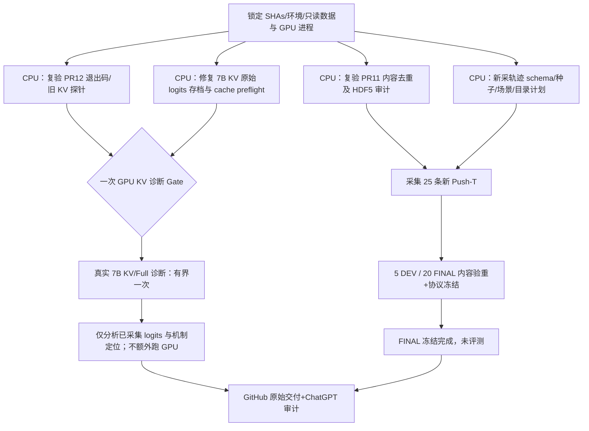

# R10 | 获批资源后的完整执行任务（DeepSeek 一次性交付）

> **Mission**：`RD-R10-AUTH-20261020-01`  
> **授权记录**：研究负责人在 2026-10-20 的 R9 交叉审计答复“我批准了”，对应上一轮提出的 **1 次有界 7B KV GPU 诊断**与 **Push-T 新采 25 回合（5 DEV / 20 FINAL）**。  
> **当前状态**：`AUTHORIZED_NOT_EXECUTED`。创建本文、收到授权、存在命令或环境变量，都 **不等于** GPU/采集成功。  
> **上游科研证据**：见仓库根 `ROUTE.md`；R9 代码基线/四线产物均不改写。  
> **执行**：DeepSeek；**独立审计**：ChatGPT；**训练预算与生产部署**：仍需研究负责人再次批准。

## 0. 固定输入与保护范围

基线固定（检查完整 SHA；只用干净独立 worktree）：

| 类型 | 不可漂移 SHA |
|---|---|
| R8 审计基线 | `review/r8-three-lane-contract-audit@52422372e5eacdcd0ee841ef2b91bdc5a71066c7` |
| A 冻结契约 | `experiment/r9-freeze-64train@f7b8b39e2394772ae6b2d8d929c7a0ba0fb10ed9` |
| B 入口 | `feature/r9-vla-trainer-contract@1cd50f1ae447a73289fd3a2dfd24eb14e973681d` |
| C 探针 | `diagnostics/r9-kv-same-prefix@02735bc2f16d60275ece01526f68860feafd5054` |
| D 数据协议 | `research/r9-new-test-readiness@f8e43b0ca6ccaa8a5711e338ba12e0f3be69328f` |
| D 独立安全补丁 | Draft [PR #11](https://github.com/jho887891-sudo/robo/pull/11) `93faece89a101b4fc31071781d6297eab121783a` |
| C 独立安全补丁 | Draft [PR #12](https://github.com/jho887891-sudo/robo/pull/12) `026d48e0e5efbdee58eb31185a8bb135b0ffba09` |
| `main` | `329614f54d3090b9b6ab120855ba50fbc93bdd1e`，**只读** |

**允许**：CPU 诊断/最小修复/回归和独立推送；一次 KV GPU 诊断；按约定新采 25 个 Push-T 回合及其只读元数据检查/冻结。数据采集可使用现有已获准的 RoboDojo expert/仿真程序，但必须与 KV GPU 窗口分开、不抢占他人 GPU，不自动进行任何 OpenVLA 优化。

**禁止**：任何 7B optimizer.step、延长 KV 到第二次诊断、官方全集下载、扩大新采超过 25 回合、把旧轨迹改名当新数据、查看尚未冻结的 FINAL 模型成绩、变更 `main`、覆盖旧 HDF5/权重/日志、合并 PR、正式机器人部署或跨任务充数。失败只停依赖子树，其他 CPU 与独立取证继续。

## 1. 并行/串行依赖图

CPU 可以并行；GPU 与可能占用 GPU 的 Isaac Sim 采集必须串行，且不影响他人任务。如果出现长时间资源不可用，按 `BLOCKED_RESOURCE` 收口，不越权抢占。单条任务失败不影响无依赖的线。

## 2. 先行 CPU 闸门（实际 GPU/采集前必须过）

### P0：复验独立审计 PR

1. 从 PR #11 的独立审计 SHA 获取 `tools/r9_final_disjoint.py`、`tests/test_r9_final_disjoint.py`，在真实 Python 环境运行合成正负对照；用 **旧 100 的清单**做跨数据集内容去重，尤其是“把旧回合换文件名”、“原 state/action 相同但 instruction 不同”。缺字段、参考哈希不同、重复或 14D/时间轴不合法，必须 fail-closed。
2. 从 PR #12 的 SHA 验证：`--gpu-diagnose` 无授权退出码 7，有授权但未实际执行返回非 0（应为 8）；确认调用真实 `r8_smoke.py --kv-diagnose` 而不是看守卫命令成功。
3. **新发现**：旧 `tools/r8_eval_manifest.py::freeze` 自身没有强制 g1–g6；若不经外围 Gate，可冻结不合格数据。新增极薄的 `r10_freeze_guard`，要求 `verify`、跨旧 100 完整内容/状态动作 hash 去重、内部去重、实际 HDF5 schema、任务、25Hz、三相机、14D、回合数满足时才能进入 freeze；状态与证据必须可重算。绝不能靠协议文件写着规则就视为工具实现了规则。
4. **额外纠错**：旧 `r8_smoke.py::kv_diagnose` 虽号称保存“完整 256-bin logits”，实际 `steps` 只含 `max/mean Δ`、margin 和 argmax。必须**在本次 GPU 前**以不改模型数学的最小补丁，为每步追加 `logits_full[k,256]` 与 `logits_kv[k,256]` 小型 `.npz` sidecar；JSON 写其 sha256、shape、dtype、对应同一前缀 token 列。否则本次 GPU 不能认作诊断成功。
5. 检查 `kv_diagnose` 在低空闲显存路径会执行 `gradient_checkpointing_enable()`，并与 `use_cache=True` 可能冲突（历史出现过）。在 CPU 源码层做精准防冲突保护，拒绝 `past_key_values is None`，不在未经测试的路径静默改 flag；用 mock/stub/静态和负例证明。
6. 开始真实任务前重跑 A 冻结合约的元数据与来源 SHA、B 的 42D/R/codec 无更新 trace、动作维度 `14` 与 token 窗口 `31744..31999`，记录 `prismatic` 在该任务的 LIBERO `ACTION_DIM=7` 风险。不要动旧 evaluate 的历史证据。

所有修复在 **R10 独立审计/执行分支**，新增回归并保存原始失败；不回写 R9、R8 证据。最多两轮同一缺陷的最小修复；两轮仍失败则相应任务 BLOCKED，不降低 Gate。

## 3. 唯一获批的 7B GPU 诊断：KV vs full（1 次，≤5 分钟）

**准入**：
- 本轮 CPU P0 全部完成并可复算；使用完整的 **64 TRAIN-only** frozen q01/q99；`S,V,Acc` 使用 signed-motion q99。
- 启动时 `torch.cuda.mem_get_info()` 实测可用空间 **至少 24 GiB（2^30 单位）**，且确认共享进程没有被强制停止；没有空闲或资源冲突则 `BLOCKED_RESOURCE`。
- 无训练、无 optimizer 初始化与步数；禁止修改模型或使用旧 80-episode 契约。所有变更只为修复 probe/记录 sidecar，不做额外实验。

**执行**：
- 记录 `nvidia-smi` 前后、进程 PID / 空闲显存、环境版本、模型 SHA、probe SHA、contract SHA、完整命令/退出码。
- 在独立输出目录以外层 `timeout 300s` 做 **一次**实际 `diagnostics/r8_smoke.py --kv-diagnose --norm-contract <R9 frozen 64TRAIN> --min-free-gb 24 --out <new dir>`；运行总时限含权重加载。超时、OOM、缓存为 None、出现资源干扰必须停止并保留原始 stderr/stdout；不要自行重复第二次。
- 14 步：强制相同 full-path teacher-forced 历史；保存每步完整 **256-bin KV logits / full logits**、token、position/cache 长度、logit 最大/均差、top1-top2 margin、首次分叉位置、dtype / 模型和探针 SHA；明确 `step0` 与使用缓存后步骤的边界。
- 将 **bf16 数值敏感**、**prefill/cache token 偏移**、**mask/position 差异**、**视觉/投影路径差异**作为并列假设。阈值 `0.05` 不是“bf16 证明”。如果尚不能区分原因，诚实标 `OPEN_UNRESOLVED`，停 GPU，安排后续小预算申请而不是越权进行 fp32 重跑。

**Gate GPU PASS 的含义**：一次诊断已真实执行、sidecars 可独立重算、完整前缀比较具有正确语义。**不要求 14/14 一致才能称“诊断执行合格”，但若失配，功能 Gate C 仍 FAIL/OPEN，不解锁训练。** 各类状态独立标记 `DIAG_EXECUTED` / `KV_EQUIVALENT` / `ROOT_CAUSE_RESOLVED`。

## 4. 已获批新采 Push-T 25 回合（严格独立 FINAL）

**采集总量**：恰好 **25** 个新回合；5 个 `NEW_DEV`、20 个 `NEW_FINAL`。每回合同一 `push_T` 任务、同一 `arx_x5` 机器人、`cam_head/cam_left_wrist/cam_right_wrist` 三路 RGB、14D state/action、25 Hz；机器人专家动作语义 `A[t]` 为下一时刻关节目标。全新目录及唯一 `run_id`，绝不覆盖旧 100 HDF5。来自 **新仿真执行/新随机初始状态**，不是复制/重命名旧文件；固定每集随机种子、场景、初始块/目标位姿、episode hash 和 expert 版本。

**采集步骤**：
1. CPU 静态探测现有 expert 程序、任务配置和 HDF5 writer，做零采集 dry-run，检查保存路径只指向新目录；记录 simulator / expert / task config 的 SHA。
2. 在不与 KV 诊断/其他共享 GPU 进程冲突的独立采集窗口，执行新 25 回合；失败回合保留失败日志但不得把旧数据补数。若 25 次预算后有效回合不足，不额外采集，标 `PARTIAL_BLOCKED`。
3. 对每个回合 HDF5 做可读性、至少 100 帧、三个真实 RGB 流存在且时间轴与 state/action 对齐、频率 25Hz、14D、指令与任务、有限数值、关节边界/物理参数、合理的初始条件覆盖检查；检查绝对文件大小不只是 9KB 占位。
4. 使用旧 100 `manifest_existing100.json` 与其**协议绑定的数据集 hash**，既比较 filename，又比较 content_SHA256、state_action_SHA256；查新集内部重复与几乎重叠（状态动作轨迹有明显复用时须人工/脚本进一步核对）。每个负例应失败；源相同名称不同 hash 也必须拒绝以满足协议。
5. 采集完成后按照协议 seeded content-hash 稳定分配 **5 DEV、20 FINAL**，保存名单哈希。确保 TRAIN、旧 DEV、旧 20、全新 DEV 和 FINAL 没有相同回合内容。旧数据的分布统计只供覆盖参考，不得看 FINAL 模型推理表现再改采集。
6. 冻结 **两套 manifest 与划分**，记录 protocol SHA、数据源 SHA、随机种子、仓库 HEAD、原始 HDF5 hash、只读存储路径、冻结 UTC；在 GitHub 提交 manifest/hash/small sidecar **之后**，FINAL 才具有资格进行将来的**一次**正式评测。**本轮不运行 FINAL 模型评测**；只做数据结构、划分、哈希与覆盖审计。任何冻结后重新采集/改文件都会使该回合失去 FINAL 身份。
7. 预注册评测沿用 `protocol/r9_eval_protocol.json` 的指标与旧 20 的探索性定位；新的 FINAL 用于未来锁定策略后的测试，不能在本轮因为“模型不够好”而调阈值或反复重用。

**特殊提醒**：官方增量下载**不在本轮授权选定的新采路线内**，不允许未经再次批准偷偷换成下载。异任务 stack_bowls/sweep_blocks 仅能作迁移研究，不能充当 Push-T FINAL。

## 5. 提交材料与机器可读 Gate

每条独立工作线有独立分支/完整 SHA，根路径建议 `evidence/r10_<UTC>/`，不上传原始 25 个巨型 HDF5、7B 权重、密钥。最小交付为：

- `report/R10_STAGE_READINESS.md`：四线状态与依赖，可清楚区分授权、执行、真实 PASS、BLOCKED；
- `report/R10_KV_ROOT_CAUSE_AUDIT.md`：GPU 对照解释/竞争假设与原始 256-bin logits sidecar 哈希；
- `report/R10_NEW_DATA_PROVENANCE.md`：25 回合真实采集状态、5/20 划分、场景/种子/轨迹分布/文件大小/内容与旧集去重及失败记录；
- `mission/R10_MISSION_MANIFEST.json`：完整固定 SHA、GPU 实测/用时/次数/退出码、数据资产目录（只读）/大小/hash、复算命令、是否训练、权限边界、所有 Gate 逐项状态；
- `evidence/r10_<UTC>/`：原始命令、每次修复前后失败日志、CPU 回归、环境 SHA、GPU 输出（如果运行）、采集与 manifest/冻结证据（如果运行）；
- 更新 `ROUTE.md`：**只追加 R10 实际发生的部分**，在完整日志与固定 commit 存在之后追加，不能凭执行计划写作“完成”。

**Gate 终止条件**：内容污染、数据丢失、资源干扰、缺少空闲显存、缓存失效、超过 5 分钟或第二次 GPU 需求、额外采集需求、恢复旧 HDF5 的尝试、出现任何 OpenVLA optimizer step、非预期直接写 `main`，都停止受影响任务并报告；无依赖 CPU 路线可继续。

**交叉审计 handoff**：最终仅回传每条 PR/HEAD SHA、`R10_MISSION_MANIFEST.json`、小型原始证据路径；ChatGPT 独立审计不只读 README，复算分位数/内容哈希/Logits；发现 Bug 在新审计分支修复并加回归，不改旧证据。

## 6. DeepSeek 接到本文件之后

把整份文件当作一次性的、可连续执行的授权任务；无依赖 CPU 工作并行，真实 GPU 与仿真新采按资源排队，**只在上述明确授权范围内**自动进入后续阶段。不能自动请求普通小步骤确认；不能自行开始任何 7B 训练。GitHub 必须保存历史、失败、负例和每次真实运行证据。若预算或权限不允许执行则标 BLOCKED 并交付已有工作，而不是写 PASS。

**ChatGPT 当前窗口没有访问远程 A6000/Isaac Sim 的执行控制权，因此创建本文件不等于已远程运行 R10。**
