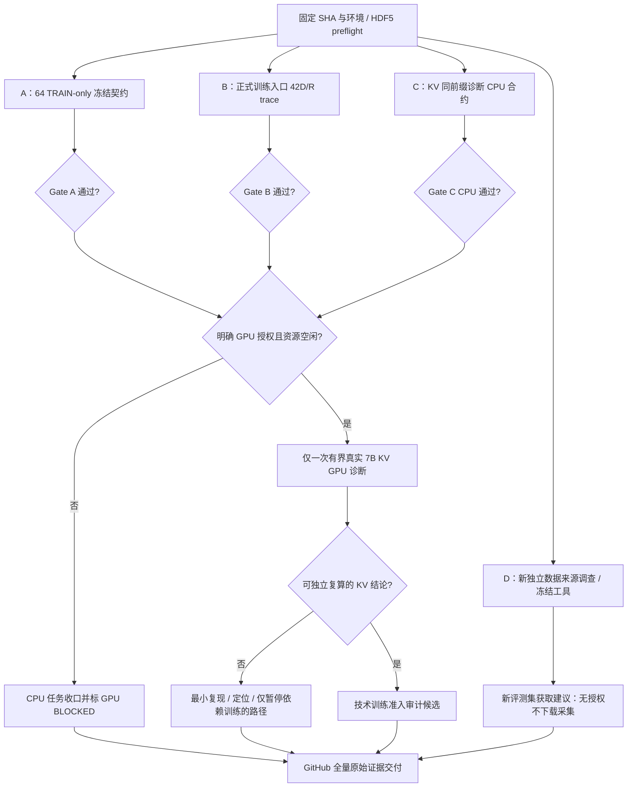

# R9 阶段完整科研执行地图 | RoboDojo / OpenVLA

> 档案 ID：RD-R9-GATE-20261020-01  
> 状态：**PLANNED / 未执行**；编制日期：2026-10-20。  
> 执行代理：DeepSeek；独立审计：ChatGPT；研究决策与 GPU/数据授权：用户。  
> 固定基线：`review/r8-three-lane-contract-audit@52422372e5eacdcd0ee841ef2b91bdc5a71066c7`（[PR #10](https://github.com/jho887891-sudo/robo/pull/10)，目前 Draft）。  
> **整份档案就是一个可连续执行的任务，不需要分阶段向用户索要新提示词，但不可越过明确授权边界。**

## 1. 科研位置：已证实、待证实、不能宣称

**研究目标**：把三帧历史本体状态 `[S,V,Acc]` 42D 和目标 `R=(A-S)-V` 以信息保真的方式连接到真实 OpenVLA-7B 训练数据、标签、Loss 和自回归推理路径，在正式训练前收口剩余技术 Gate。最终目标是 RoboDojo / Push-T **闭环成功率**，当前仅有离线状态预测证据。

**已有可查证据**：

| 路线 | 原分支与 SHA | 已知结果及限制 |
|---|---|---|
| R8 轻量基线 | `audit/r8-pretraining-readiness@a2b71805d8abb9314bcca5025aa9e449c525a08e` | 19,127 帧三帧 MLP L1=0.001186，恒速=0.001795，R²≈0.536，旧留出 20/20；**不是 VLA/闭环证据** |
| A 有符号归一化 | `experiment/r8-motion-normalization@22d0a95c9a27f1ef187cbce02edefd599f2f49d8` | 原位置界归一化 V/Acc 约 30.7%/31.6% 裁剪；64 TRAIN/16 DEV 对照选 `signed_motion` q99，DEV L1 0.001166→0.001113 |
| B 真实 7B Smoke | `feature/r8-vla-42d-smoke@6b1559772f5fd084e6ebde1a624a0cc8468c905a` | 7B 加载、42D projector、梯度通过；KV vs 全序列 **8/14**；未验证标准训练入口 |
| C 独立评测准备 | `research/r8-independent-evaluation@4f28417c18747bc2b208650b690b444f4d7a8678` | 本机旧 100 Push-T 回合均已进入 R2–R8 数据划分；无全新最终测试集 |
| ChatGPT 审计补丁 | `review/r8-three-lane-contract-audit@52422372e5eacdcd0ee841ef2b91bdc5a71066c7` | 修复目标分位数混 DEV、Smoke 不读取冻结目标分位数、KV 诊断前缀不同；该 SHA 的 R4/R5/R8 Frozen CPU Actions PASS；**新真实 HDF5 和 GPU 尚需执行** |

**三个关键待验问题：**
1. 冻结目标 q01/q99 是否严格来自 64 TRAIN，而非旧 80 episode（含 16 DEV）或 Smoke 里的 20 episode？
2. 42D/有符号归一化/R 目标是否真正穿过**标准训练入口**？现有 `training/train_pushT_pure2.py` 的常规 `build()/obs()/action_stats()` 仍是旧 14D 与原目标模式。
3. KV-cache 与 full forward 不一致，是 cache、因果 mask、位置、token 历史、模型精度中的哪一种？不得根据 argmax 分叉后的不同上下文猜测原因。

旧 20 留出回合已反复用于研究选择，不能重新称为全新最终测试。

## 2. 任务地图：有依赖才等待



- A/B/C/D 的**无数据依赖部分**并行开发、运行 CPU 测试；重型 GPU 仅一个窗口排队，不抢占其他任务。
- A 冻结元数据未通过时，B 允许开发 mock/CPU trace，但不能宣称真实模型集成完成。
- 任何任务失败只阻塞其依赖子树，其他任务继续。最多两轮**最小化修复 + 新回归 + 原始失败留证**，不得放松验收标准。

## 3. A：真实 HDF5 上重新冻结完整契约（P0，CPU，可立即执行）

从本档案固定基线的**独立 worktree**执行（先核对 SHA/工作区/真实 HDF5/分割/依赖）。参考：

```bash
export R9_OUT=/home/dgut/pusht_runtime/r9_gate_$(date -u +%Y%m%dT%H%M%SZ)
mkdir -p "$R9_OUT"
python -m py_compile tools/make_frozen_contract.py diagnostics/r8_smoke.py
python tests/test_r8_frozen_metadata_audit.py
python tests/test_r8_normalization.py
python tests/test_r8_vla_adapter.py
python tests/test_r8_contract.py
python tools/make_frozen_contract.py \
  --contracts evidence/r8_vla_42d_smoke_20261020/frozen_norm_contracts.json \
  --scheme B99_signed --episodes 0 \
  --out "$R9_OUT/frozen_contract_64train.json"
python diagnostics/r8_smoke.py --check-contract \
  --norm-contract "$R9_OUT/frozen_contract_64train.json" \
  --out "$R9_OUT/cpu_contract"
```

**严格 Spec：** 
- 与 R7/R8 一样用 `split_episodes(split["train"], n_dev=16)`，64 TRAIN、16 DEV、20 旧 holdout 互不重叠，保存固定 episode 名单和哈希；禁止未来帧进入输入。
- `P=[S,V,Acc]`，每槽 14D。 `V_t=S_t-S_{t-1}`；`Acc_t=S_t-2S_{t-1}+S_{t-2}`；t0 V/Acc=0，t1 Acc=0。
- S 使用原位置边界；V/Acc 使用方案 A 仅 64 TRAIN 拟合的 `signed_motion` q99(|motion|)，零运动必须映射零，符号保真；沿用实际 A 的 DEV 决定，不重新看旧留出调参。
- `R_t=(A_t-S_t)-V_t` 的 14D q01/q99 **同样只能**从 64 TRAIN 拟合；旧 80 TRAIN 的冻结文件仍要保留，但须在新路径 fail-closed 拒绝。
- 256-bin 固定 codec，训练/预测/CPU Smoke 必须读取**同一份** frozen q01/q99；夹爪 dim 6/13 维使用 DEV 选定的恒速规则；反变换 `Ahat=S+V+Rhat`。
- 冻结元数据记录数据 IDs/hash、训练划分 SHA、规范版本、归一化尺度、R 分位数、模型/代码 SHA、时间规则与检查点字段。

**Gate A（全部需证据）**：无 TRAIN/DEV 重叠、无旧 20 用于拟合；元数据形状/有限性/版本与真实 CPU 解码一致；旧 80 episode 元数据报错拒绝；所有真实 HDF5 合约测试确实执行且未因缺数据 skip；新 JSON、原始命令、退出码、SHA 留档。

## 4. B：真实训练入口接线与 no-update trace（P0，CPU 先行）

目前 GPU Smoke 使用 `r8_vla_adapter` 手动向模型传入 42D projector，却**不能替代** `train_pushT_pure2.py` 正式训练入口的全链路验证。

**实现原则**：优先新建 `r9_*` 入口/显式模式开关，不破坏既有 14/28D 历史路线和原权重；模型日后加载错误契约必须报错。

**必要输入/输出契约：**
- 三路 RGB + 英文指令 + 当前及历史三个已观测 `S`，同一时间戳与同一 episode 边界；train、DEV、在线 history buffer 索引一致。
- 42D [S,V,Acc] 使用**A 冻结**缩放，训练标签是 R 而非 Δ 或绝对动作；所有 q01/q99 来自冻结文件；目标 token 和 loss mask 与 14 token 自回归一致。
- `ProprioProjector(42,4096)` 的真实调用路径、视觉 token、动作位置 mask / KV prefix、LoRA 与 projector 参数优化开关明确。
- 模型输出 14 token 解码为 R，再通过 `S+V+Rhat` 重建 14D 目标并裁到物理关节边界；夹爪 6/13 固定恒速。
- checkpoint metadata 记录输入模式、目标模式、codec、量化分位数、归一化、time/index 规则、代码/数据 SHA；旧 ckpt 显式兼容或拒绝。
- 实现**零优化器步骤**的 CPU 数据 trace（合适时 mock forward），保存逐帧 shape、索引、样本哈希、缩放、标签、预测解码与 manifest；不可把 mock PASS 冒充真实 7B GPU 训练成功。

**Gate B**：真实 HDF5 loader → 42D → R → frozen bins → 14 action tokens → loss/解码的单批次 trace 完整且无未来泄漏；新增回归 PASS；旧 14/28D 行为未被悄悄更改；若有需要真实 7B CUDA 才能验证的部分，应标 PENDING_GPU，不允许运行未经批准的 GPU。

## 5. C：查明 KV-cache，不盲目加训练（P0，CPU + 授权后一次 GPU）

**已有失败**：旧真实 7B KV/full 8/14 token 一致。原 KV 诊断在首次分叉后比较各自历史，得到的后续 logits 不可比。PR #10 已修正为 full-path 的 token **teacher-force 同一前缀**进 KV 分支，确保两边 step k 的输入历史一致。

**先执行 CPU 级别合约/最小实验**：
- 检查 `--kv-diagnose` 的 `past_key_values` 连续传递、图像与文本只在 prefill 正确输入、position IDs、causal mask、action token index（31744 起连续 256 bin）、每个 step 同一 token 前缀、退出码和独立 log。
- 对齐保存每一步两路全部 256-bin logits、max/mean absolute difference、top1/top2 margin、argmax、首次分叉位置、精度/设备/模型 SHA。
- 若 `margin <= 2 * max|dlogit|`，仅说明翻转与已观察 logit 差数学上兼容，**不能**据此断言 bf16 数值误差就是根因；仍需精度控制/定位模型结构。
- 对照候选假设：H1 bf16 数值敏感；H2 prefill/cache token 偏移；H3 mask/position 错误；H4 projector/视觉融合或其他推理路径差异。为每种设置可区分诊断，不允许事后降阈值。

**Gate C-CPU**：语义正确、共同前缀测试通过、发生 KV 不一致时不会假 PASS、提交最小对照和完整日志。**Gate C-GPU** 仅在 Gate A+B+C-CPU 通过且用户**明确批准一次 GPU 诊断**后启动：

```bash
python diagnostics/r8_smoke.py --kv-diagnose \
  --norm-contract "$R9_OUT/frozen_contract_64train.json" \
  --min-free-gb 24 --out "$R9_OUT/kv_gpu_diag"
```

建议单次窗口最多 **5 分钟含权重加载**，总计最多 **1 次**，GPU 空闲显存至少 24 GB；不影响现有 GPU 进程，OOM/干扰/超时立即停并留证。失败/仍不能区分根因则标 OPEN，不训练。该额度只是**待用户审批的上限**，本档案不构成 GPU 许可。

## 6. D：新独立 Push-T 测试数据准备（P1，独立 CPU）

使用 C 工作线 `research/r8-independent-evaluation@4f28417` 的工具和协议。只可做：
- 已有轨迹和官方数据**元信息**清点、资源可行性调查，不实际下载。
- `tools/r8_eval_manifest.py` 的重复哈希/目录交叉检查、负例测试、冻结 protocol 与评测命令准备。
- 两条备选：官方独立增量轨迹优先（先查是否真的与旧 100 集内容不重叠），或经研究负责人授权后由专家脚本新采 20–30 集。
- 报告至少包含采集/下载预算、回合去重证据、覆盖维度、预冻结 manifest 条件、DEV 与 FINAL 不重叠，以及跨任务数据不能冒充同任务最终测试。

**不许自动下载/采集/看全新 FINAL 的模型表现。** 如无授权，D 输出完整准备报告并标 `BLOCKED_DATA_ACQUISITION_AUTHORIZATION`，不能虚构“独立评测成功”。

## 7. 自主运行、资源与停止规则

**本轮已经许可**：CPU 多任务开发、真实 HDF5 只读诊断、静态/回归测试、提交独立分支和小型证据、修复最小缺陷。CPU 每个工作包建议执行预算上限为 2 小时，可并行；若首次失败，保留原始日志并允许最多 2 次小范围修复/复跑。不是预计完成时间。

**未授权（全部禁止）**：7B 训练任意优化步、3000/6000 步训练、额外重型 GPU 任务、下载/采集新数据、覆盖 HDF5/旧 checkpoint/旧实验报告、修改 `main`、合并 PR、在线机器人正式部署。

**自动继续条件**：只要上游 Gate PASS 且任务在已有权限/预算内，DeepSeek 自动进入后续子任务，无须用户逐步确认。若出现 FATAL（数据泄漏、目标/时序不一致、证据丢失、外部 GPU 被影响、权限不足、预算耗尽或同一缺陷两轮失败），只暂停受影响子树，其他独立线继续。技术原因不明时转入机制诊断，不以增加步数掩盖错误。

**当前研究重点**：证明完整输入链路可复算和缓存机制可信，不以“运行多长时间”作为成功指标。

## 8. GitHub 交付合同（DoD）

DeepSeek 按工作包拆独立分支和 worktree，建议：
- `experiment/r9-freeze-64train`（A）
- `feature/r9-vla-trainer-contract`（B）
- `diagnostics/r9-kv-same-prefix`（C）
- `research/r9-new-test-readiness`（D）

提交：
1. `report/R9_STAGE_READINESS.md`：**一页全景地图**，工作包完成/阻断/依赖/Gate。
2. `report/R9_FROZEN_CONTRACT.md`：64 TRAIN/16 DEV/20 旧留出，原始统计、差异、SHA。
3. `report/R9_TRAIN_ENTRYPOINT_TRACE.md`：42D/R/codec/loader 的数据流与逐层 shapes。
4. `report/R9_KV_DIAGNOSIS.md`：同前缀 256-bin 原始 logits、首个偏差、竞争假设、判定与未决。
5. `report/R9_INDEPENDENT_EVAL_PREP.md`：新数据获取/冻结方案与风险。
6. `evidence/r9_gate_<UTC>/`：原始 CPU/GPU（若有）日志、每条命令、退出码、环境/包版本、数据/代码 SHA、JSON、小型 sidecars、失败记录；**不上传大权重/原始 HDF5/密钥**。
7. `mission/R9_MISSION_MANIFEST.json`：固定 mission ID、每个 Gate 的 PASS/FAIL/BLOCKED、验证设备、源 SHA、证据路径、是否真正运行、复算命令、超预算/未决项，杜绝用“全通过”替代逐项证据。

**必须保留旧 80 TRAIN 分位数和 KV 8/14 的失败历史，不得覆盖。** 不能访问/无法运行的验证只能标 IMPLEMENTED 或 BLOCKED。PR 对应具体新 SHA，默认 Draft，不自动合并。

## 9. 返回 ChatGPT 的独立审计入口

任务执行完毕，DeepSeek 只需交付 GitHub **PR / 每线 HEAD SHA / mission manifest / 完整证据路径**。ChatGPT 按以下固定顺序审计：

1. 核对实际 commit SHA、每个文件 diff、旧 main/原证据不变。
2. 直接查看原始日志/sidecars 和源码，不只看 Markdown 总结；独立检查数据划分、冻结 64 TRAIN-only bins、42D 归一化、动作恢复、KV mask/position/cache。
3. 能独立复算的原始记录复算；不能获取真实 HDF5/GPU 日志时明确说明证据范围，不冒称亲自运行。
4. 发现 Bug 在独立审计分支最小修复，补回归并提交新 PR；**不改写 DeepSeek 旧证据**。
5. 标注每个 Gate 为 VERIFIED_CPU / VERIFIED_HDF5 / VERIFIED_GPU_SMOKE / IMPLEMENTED / BLOCKED / HYPOTHESIS；只解锁有依赖证明的阶段。
6. 决定是否达到**可以提交小规模 GPU 训练申请**的技术条件，但预算与启动仍由研究负责人批准；没有全新独立数据不能做最终泛化声称。

## 10. DeepSeek 直接开始执行

**收到完整档案后自动开始：**核对上述 GitHub SHA 与本机数据和 GPU 占用，CPU A/B/C/D 多线并行，A/B 有依赖时按 Gate 分阶段；本轮自主完成已授权的全部任务，遇到阻断仅停受影响工作。未获用户明确批准时，不启动 KV GPU、不下载/采集、不开始任何 7B 训练。最终交付全部 GitHub 原始证据和机器可读 manifest 供 ChatGPT 审计。**不要每个小步骤回来请求新安排。**
